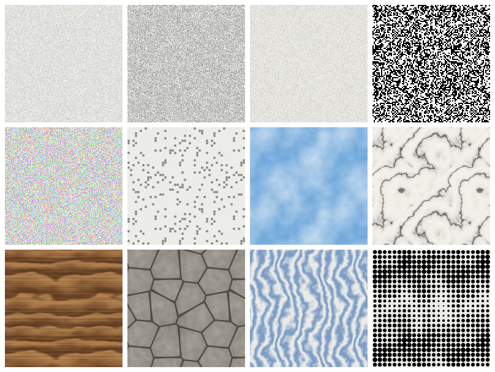

# Noise Texture для FigCraft

Порт Figma-плагина [Noise & Texture](https://www.figma.com/community/plugin/1138854718618193875/noise-texture)
на [FigCraft](https://github.com/storytold/figcraft) — открытую альтернативу Figma на Rust.
Плагин генерирует бесшовные тайловые текстуры (шум, зерно, облака, мрамор, дерево, ячейки, волны,
полутон) и добавляет их в заливку выбранных слоёв как тайловое изображение — либо создаёт новый
слой с текстурой, если ничего не выбрано.

> **English.** A FigCraft port of the Figma plugin *Noise & Texture*: seamless tiled noise, grain and
> procedural textures added to the selected layers' fills as tiled image paints, with a panel, live
> updates and presets. Import `plugin/figcraft-plugin.json` via *Plugins ▸ Development ▸ Import
> plugin from manifest…*.



Это независимая реализация, написанная с нуля: код оригинального плагина не использовался (он
закрыт), поведение воспроизведено по его публичному описанию. Проект не связан с автором оригинала
и с Figma.

## Установка

1. Скачайте `noise-texture-<версия>.zip` со страницы
   [Releases](https://github.com/ATiKE1/noise-texture-figcraft/releases) и распакуйте его.
2. В FigCraft: **Plugins ▸ Development ▸ Import plugin from manifest…**
3. Выберите `noise-texture/figcraft-plugin.json`.

Тот же плагин лежит в папке [`plugin/`](plugin/) репозитория (манифест + собранный
`noise_texture.wasm`): можно импортировать `plugin/figcraft-plugin.json` прямо из клона.

После импорта в меню **Plugins** появится **Noise Texture** с командами:

| Команда | Что делает |
|---|---|
| **Noise & texture…** | Открывает панель со всеми настройками, пресетами и живым обновлением. |
| **Add noise…** | Форма со всеми параметрами: добавляет текстуру без панели. |
| **Add preset…** | Добавляет один из встроенных пресетов. |
| **Remove texture** | Снимает с выбранных слоёв текстуру, добавленную плагином (остальные заливки остаются). |

Нужен FigCraft с поддержкой плагинов API 2 (панели и настройки). Плагин проверен на ревизии
FigCraft [`80f9163`](https://github.com/storytold/figcraft/commit/80f916326fb94f3a88cb24e64f396f564a0ebc06).

## Как пользоваться

1. Выделите слои (прямоугольники, фреймы, текст, фигуры) и откройте **Plugins ▸ Noise Texture ▸
   Noise & texture…**.
2. Выберите пресет или тип текстуры и настройте параметры.
3. Нажмите **Apply**: текстура ляжет поверх существующих заливок слоя. Если ничего не выбрано,
   появится новый слой 400×400 с текстурой в центре экрана.
4. Пока панель открыта и включено **Update selected textures live**, любое изменение параметра сразу
   перерисовывает текстуру на выбранных слоях, у которых она уже есть.

Повторный **Apply** на слое заменяет текстуру, добавленную плагином раньше, а не накладывает
новую. Если открыть панель с выделенным текстурированным слоем, она подхватит его настройки — так
текстуру можно отредактировать позже. **Shuffle** меняет seed (вариант случайного узора), **Remove**
снимает текстуру. Пресет можно сохранить: введите имя в **Preset name** и нажмите **Save preset**;
сохранённые пресеты появляются в списке **Preset** и хранятся в настройках плагина.

Каждое изменение в панели — один шаг отмены (Undo), как и запуск команды.

## Параметры

| Параметр | Значения | Смысл |
|---|---|---|
| Texture (`type`) | Static, Grain, Clouds, Marble, Wood, Cells, Waves, Halftone | Вид текстуры |
| Particle size (`size`) | 1–64 px | Размер частицы (пикселя шума); для процедурных текстур — пикселизация |
| Feature scale (`scale`) | 2–512 px | Размер деталей: облаков, расстояние между прожилками, кольцами, ячейками, точками растра |
| Amount (`density`) | 0–100 % | Плотность частиц / покрытие процедурной текстуры / тон полутона |
| Detail (`detail`) | 1–8 | Число октав шума, сила завихрений |
| Particle shape (`shape`) | Square, Circle | Форма частицы (заметна при размере от 2 px) |
| Colours (`colorMode`) | Single colour, Two colours, Random colours | Один цвет с прозрачностью; смесь двух цветов; случайный оттенок на каждую частицу |
| Particle colour / Second colour (`color`, `color2`) | `#RRGGBB` или `#RRGGBBAA` | Цвета частиц |
| Particle opacity (`opacity`) | 0–100 % | Непрозрачность частиц |
| Background, Background opacity (`background`, `backgroundOpacity`) | цвет, 0–100 % | Подложка тайла (по умолчанию прозрачная) |
| Blend mode (`blend`) | Normal, Multiply, Screen, Overlay, Soft light, … | Режим наложения заливки |
| Tile size (`tile`) | 16–512 px (в панели 64/128/256/512) | Размер повторяющегося тайла |
| Seed (`seed`) | 0–999999 | Вариант случайного узора; одинаковые настройки дают одинаковый тайл |

Встроенные пресеты: Fine grain, Film grain, Paper, TV static, Colour static, Speckles, Clouds,
Marble, Wood, Stone, Ripples, Halftone.

## Скрипты, CLI и MCP

Команды плагина доступны так же, как любые команды FigCraft. Пример —
[`examples/scripts/demo.jsonl`](examples/scripts/demo.jsonl):

```sh
figcraft-cli run examples/scripts/demo.jsonl --out demo.figcraft
```

```jsonl
{"command": "plugin.import", "params": {"path": "plugin"}}
{"command": "select.all", "params": {}}
{"command": "plugin.run", "params": {"id": "io.github.atike1.noise-texture", "command": "preset", "params": {"preset": "Film grain"}}}
{"command": "plugin.run", "params": {"id": "io.github.atike1.noise-texture", "command": "apply", "params": {"type": "Marble", "colorMode": "Two colours", "tile": 256}}}
{"command": "plugin.run", "params": {"id": "io.github.atike1.noise-texture", "command": "remove"}}
```

Панелью тоже можно управлять из скрипта: `plugin.run {command: "panel"}`, затем
`plugin.event {control: "density", value: 30}`, `plugin.event {control: "apply"}` и т. д.

## Как это устроено

- Плагин — модуль WebAssembly на Rust с манифестом `figcraft-plugin.json` (API 2). Он работает в
  песочнице FigCraft и меняет документ только через команды FigCraft: `image.place`, `fill.add`,
  `fill.set`, `fill.remove`, `node.get`, `node.set`, `edit.delete`, `select.set`, `view.get`
  (список ограничен в манифесте).
- Тайл рисуется в самом плагине: бесшовный шум (периодический градиентный шум, фрактальные суммы,
  клеточный шум) считается на решётке, кратной размеру тайла, поэтому края совпадают.
- Тайл кодируется в PNG собственным компактным кодировщиком (палитра 1/2/4/8 бит, когда цветов
  ≤ 256, иначе RGBA; deflate с фиксированными кодами Хаффмана) и передаётся в FigCraft через
  `image.place` в base64. Заливка слоя — image paint в режиме `tile`.
- Слой с текстурой хранит хэш изображения и настройки в данных слоя (`pluginData`) под ключом
  `io.github.atike1.noise-texture`, поэтому плагин находит свою заливку, заменяет или удаляет её и
  восстанавливает настройки в панели.

| | |
|---|---|
| [`src/texture.rs`](src/texture.rs) | Настройки и генератор тайла |
| [`src/noise.rs`](src/noise.rs) | Бесшовный шум на решётках |
| [`src/png.rs`](src/png.rs) | PNG-кодировщик, zlib/deflate, base64 |
| [`src/presets.rs`](src/presets.rs) | Встроенные и сохранённые пресеты |
| [`src/lib.rs`](src/lib.rs) | Связь с FigCraft: команды, панель, live-обновление |

## Отличия от оригинала и ограничения

- Перенесено ядро оригинала: шум и зерно (размер, плотность, цвет и непрозрачность частиц), фон,
  режим наложения, бесшовный тайлинг, процедурные текстуры (облака, мрамор, дерево, камень/ячейки,
  волны, полутон), добавление на холст или в слой, живое обновление, сохранение пресетов.
- Не перенесено: шейдерные эффекты версии 2.0 (дизеринг, блюр, искажения, CMYK-растр, анимация),
  режим обработки изображений, форма частицы из слоя на холсте. В песочнице FigCraft нет GPU и
  доступа к пикселям слоёв.
- Панель FigCraft рисует плагин стандартными полями: слайдеров и превью внутри панели нет.
- При живом обновлении каждый вариант текстуры сохраняется в файле как отдельное изображение
  (FigCraft не удаляет неиспользуемые изображения). Если файл разрастается, отключите
  **Update selected textures live** и применяйте текстуру кнопкой **Apply**.
- Песочница ограничивает число инструкций на запуск. Тайл 512 px с максимальной детализацией
  укладывается в лимит, но генерируется заметно дольше тайла 256 px.

## Сборка из исходников

Нужен Rust (stable) и цель `wasm32-unknown-unknown`:

```sh
rustup target add wasm32-unknown-unknown
./build.sh            # собирает модуль и кладёт его в plugin/noise_texture.wasm
cargo test            # тесты генератора, шума, PNG-кодировщика и пресетов
cargo run --release --example previews -- docs/previews.png   # картинка с пресетами
```

SDK плагинов FigCraft (`figcraft-plugin-sdk`) подключается из репозитория FigCraft по
зафиксированной ревизии.

`./package.sh` упаковывает собранный плагин в `dist/noise-texture-<версия>.zip`. В архиве папка
`noise-texture/` с манифестом и модулем, README и лицензии лежат в `assets/`. Рядом создаётся файл
с SHA-256 архива.

## Релизы

CI ([`.github/workflows/ci.yml`](.github/workflows/ci.yml)) на каждый push проверяет код (fmt,
clippy, тесты), собирает модуль и упаковывает плагин. Архив прикладывается к прогону как
артефакт.

Если сборка основной ветки прошла, CI сам публикует GitHub Release `v<версия>` с архивом и его
SHA-256. Версия берётся из `Cargo.toml` и `plugin/figcraft-plugin.json`: тест и `package.sh`
проверяют, что они совпадают. Каждая версия публикуется один раз. Чтобы выпустить следующую,
поднимите версию в обоих файлах. Релиз также создаётся при push тега `v<версия>`; тег должен
совпадать с версией.

## Лицензия

MIT или Apache-2.0 на выбор: [LICENSE-MIT](LICENSE-MIT), [LICENSE-APACHE](LICENSE-APACHE).
